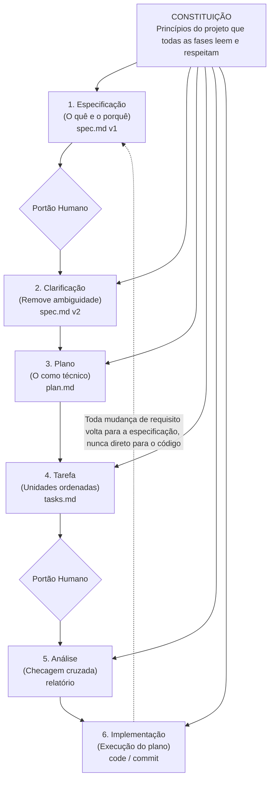

# MITR3 — CONSTITUIÇÃO OPERACIONAL E FRAMEWORK DE GOVERNANÇA

**Data:** 2026-10-21  
**Autor:** VANTA (Maestro Interino / Engenharia Reversa)  
**Referência Metodológica:** Framework Constitucional de 6 Fases (conforme diagrama de engenharia oficial)  
**Status:** ATIVO E VINCULANTE PARA TODOS OS AGENTES DO SQUAD  

---

## CONSTITUIÇÃO
*Princípios supremos do projeto que todas as fases leem, respeitam e aplicam sem exceção.*

1. **Princípio do Fail-Closed:** Nenhuma ferramenta, script ou operação com efeitos persistentes avança se houver ambiguidade, falha de validação ou risco de segurança.
2. **Princípio da Regra de Ouro:** *Toda mudança de requisito volta para a especificação, nunca direto para o código.*
3. **Princípio do Privilégio Mínimo e Contenção:** Nenhum agente opera com superfície irrestrita; gateways com isolamento (`bwrap`), namespaces e allowlists são mandatórios.
4. **Princípio da Imutabilidade das Evidências:** Provas de segurança e resultados de análise exigem hash SHA-256 e manifestos selados.

---

---

## MAPEAMENTO DAS 6 FASES PARA A OPERAÇÃO ATUAL

### Fase 1: Especificação (`spec.md v1`)
- **Documentos de Entrada:**
  - `docs/REVERSE-NEXT-GATES-G-SECURITY-ROLLBACK-v01.md`: Gates SEC-01..08 e RB-01..08.
  - `labs/ot-firmware/docs/REVIEW.md`: Diagnóstico dos 7 defeitos de hardening (`H1` a `H6`).
  - `docs/MITR3-CHROME-MCP-GATEKEEPER-SPEC-V1.md`: SEC-BROW-001 v1.0.

### Fase 2: Clarificação (`spec.md v2` após Portão Humano)
- **Ações:**
  - Confrontar `G-SECURITY` e `G-ROLLBACK` contra o Masterplan (`docs/MITR3-REVERSE-NEXT-MASTERPLAN-20261021.md`).
  - Consolidar requisitos de correção de `H1` (escape sandbox por symlink preexistente) e `H2` (tracebacks em parse).
  - Clarificar que a autorização de teste de lab não concede egress a terceiros.

### Fase 3: Plano (`plan.md`)
- **Desenho Técnico das Correções e Gateways:**
  - Implementação dos validadores de `G-SECURITY` e `G-ROLLBACK` no runner do laboratório.
  - Patch aditivo no extrator de firmware para sanar os 7 defeitos sem quebrar testes existentes.
  - Confinamento do `chrome_guarded_mcp` com perfil isolado e verificação de rede.

### Fase 4: Tarefa (`tasks.md`)
- **Divisão Ordenada por Lanes:**
  - **Lane Build / QA (Codex):** Implementação dos scripts validadores `g_security.py` e `g_rollback.py`; correção de H1–H6 em `fwlab/extract.py`.
  - **Lane Reverse (VANTA):** Validação técnica das correções nos fixtures e auditoria de não-regressão.
  - **Lane Knowledge (Hermes / Gemma4):** Documentação curada dos gates e registro das evidências no MegaBrain.
  - **Lane Web / API (DeepSeek):** Revisão de superfície do Chrome Guarded e testes de contenção de sessão.
  - **Lane Maestro (OpenCode):** Orquestração dos portões e checkpoints.

### Fase 5: Análise (Checagem Cruzada / Relatório após Portão Humano)
- **Validação Cruzada:** Execução dos 38 testes existentes em `ot-firmware` + 42 testes em `reverse-next` + 43 testes no `rea_guarded` + 7 testes no `chrome_guarded`.
- Verificação de zero tracebacks e zero escapes de sandbox.

### Fase 6: Implementação (`code / commit`)
- Execução efetiva do código, transição dos testes de `expectedFailure` para `PASS` legítimo e commit atômico no repositório.
