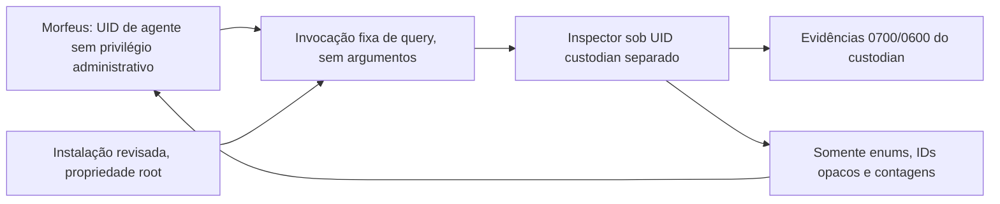

# Consulta restrita e separação de identidades — fase preparatória

Estado: **LOCAL_QUERY_PROTOTYPE / F01_OPEN / NOT_DEPLOYED**.
O [pacote preparatório de implantação](../deploy/README.md) detalha a proposta atual
por socket Unix/SO_PEERCRED, units systemd, testes negativos e rollback. A opção de
helper one-shot abaixo é a proposta histórica; nenhum mecanismo foi implantado.
`hackbots/runner/query.py` implementa o contrato de consulta; a instalação em outra
identidade e os testes reais entre UIDs ainda não foram feitos. Nenhuma conta, serviço,
permissão do host ou integração do Morfeus foi alterada nesta etapa.

## Contrato implementado

Uma invocação recebe **um frame** no stdin e responde com **um frame** no stdout.
Formato reutilizado do runner: uint32 big-endian do tamanho seguido de JSON UTF-8.
Entrada até 4096 bytes; saída até 8192 bytes. Leitura e escrita têm deadlines de 3 s;
a validação local da evidência ocorre entre essas operações e não tem deadline próprio.
Não tratar 3 s como teto total de CPU/tempo. O processo encerra após a primeira consulta;
frames adicionais não são processados. JSON duplicado, profundidade excessiva, números
não finitos, frame truncado e campos extras são bloqueados.

Requisições aceitas:

```json
{"v":1,"operation":"summary","kind":"complete","limit":10}
```

```json
{"v":1,"operation":"inspect","kind":"complete","run_id":"0123456789abcdef0123456789abcdef"}
```

`kind` aceita `complete` ou `failed`; `limit` é inteiro de 1 a 25; `run_id` usa
32 hexadecimais minúsculos. Não há operação de missão, promoção, escrita, comando,
path, configuração, worker ou política fornecida pelo chamador.

Sucesso: `{"v":1,"ok":true,"data":...}`, com a projeção já validada pelo Inspector.
Falha: `ok:false`, `QUERY_BLOCKED`, gates conservadores e nenhum eco da entrada.
O helper recusa root. CLI local: `python3 -m hackbots.runner.query` (sem argumentos).
Uso direto na instalação atual tem os mesmos privilégios de `nielz`: **não fecha F01**.

## Desenho de implantação para revisão



Para o primeiro piloto, preferir um helper de execução única gerido pelo operador
em vez de um servidor residente. Se for usado sudo, autorizar **somente um launcher
absoluto, sem argumentos, como o UID custodian**, com ambiente controlado; nunca
autorizar `python`, shell, `-m`, `-c`, `env`, `systemctl`, módulo editável ou pathname
fornecido pelo agente. A regra e o launcher precisam ser revisados e conferidos com
o validador da ferramenta instalada antes de habilitação. Nenhuma regra sudo foi criada.

O launcher deve iniciar `/usr/bin/python3 -I -B` sobre um script fixo instalado por
root, inserir somente uma raiz de código confiável no caminho de importação e chamar
`query.main([])`. Não importar de `~/MITR3`, do cwd ou de um venv gravável pelo agente.
O modo isolado do Python ignora PYTHONPATH e site-packages de usuário, mas não substitui
controle de propriedade do código e dos diretórios ancestrais.

Para reutilizar o layout atual sem refatorar os stores, uma cópia revisada pode ficar
em `/opt/mitr3-custody`, com código e fixtures/oráculos aprovados pertencentes a root;
somente `/opt/mitr3-custody/hackbots/private` pertence ao custodian (0700).
Não copiar evidências antigas automaticamente nem usar symlink para o workspace do
agente. O código deriva PROJECT da instalação, portanto consulta esse private local.
O runner de missões ainda depende de systemd de usuário: separar consulta de migração
da execução evita presumir que uma conta de serviço já tenha user bus/cgroup funcional.

**O agente deve ter UID próprio sem sudo, docker, wheel ou capacidade equivalente.**
Manter o Morfeus com shell em `nielz`, que possui grupos administrativos no ambiente
auditado, deixa uma rota de contorno mesmo que a pasta de evidências mude de dono.
O operador pode conservar seus privilégios; são as ferramentas do agente que precisam
executar na identidade restrita. Um pipe não autentica seu escritor: o controle da
invocação e da identidade é responsabilidade do mecanismo de implantação.

O protótipo não faz autorização por missão/tenant. A consulta vale apenas para um
domínio local de evidências que o operador autorize integralmente. IDs opacos não são
credenciais; múltiplos solicitantes exigem ACL de consulta e escopo no lado confiável.
Também faltam quotas agregadas de chamadas/concorrência; não expor o helper a chamadas
ilimitadas por agentes antes de controlar esses recursos.

## Testes de aceite entre identidades

Antes de marcar qualquer fechamento de F01, registrar UIDs e executar no host:

1. Como agente, tentar escrever no código instalado, launcher, diretórios ancestrais,
   fixtures e oráculos; todas as tentativas devem falhar. Verificar ACLs e grupos,
   além dos modos Unix. Código público pode ser legível, mas nunca gravável pelo agente.
2. Como agente, tentar listar/ler/escrever evidências privadas e acessar staging de
   uma execução custodian; deve falhar, inclusive com hardlink/symlink preparados.
3. Como agente, fornecer PYTHONPATH, cwd com módulo falso, argumentos extras, `run`,
   `command`, `path`, trace falso e JSON duplicado. Nenhum comando/arquivo extra deve
   ser executado, lido ou revelado; consultar evidência válida deve funcionar.
4. Confirmar que invocação como outro UID e escalada por sudo/docker/polkit estão
   indisponíveis à identidade do agente. Definir teto de chamadas simultâneas e custo.
5. Revisor diferente confere resultados e hashes da cópia instalada. Custódia protegida
   do agente não significa autenticação contra o próprio supervisor: manter
   `trace_authenticity: NOT_VERIFIED` até existir o mecanismo e contrato apropriados.

Não iniciar missões ou integrar agentes nesta etapa de consulta. O próximo aceite é
a revisão deste desenho e a instalação assistida pelo operador com teste real entre UIDs.

Fontes: [Python modo isolado](https://docs.python.org/3.14/using/cmdline.html#cmdoption-I),
[NIST SP 800-209](https://nvlpubs.nist.gov/nistpubs/SpecialPublications/NIST.SP.800-209.pdf).
São referências para o desenho; não certificam esta implementação ou sua implantação.
