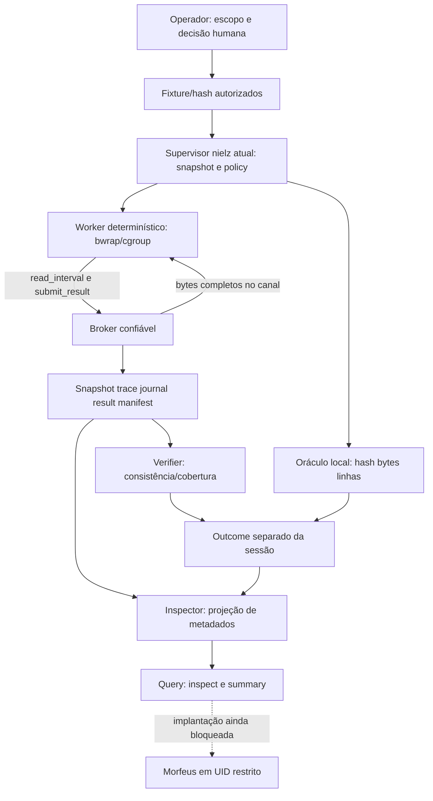

# Hackerbots — arquitetura implementada e visão pretendida

## Estado observado

Builder, Evaluator, Verifier, Policy/IPC, Snapshot, Broker, Runner, Sandbox,
Trace/Failure/Outcome stores, Inspector e Query Adapter existem. A baseline local
é reexecutada no relatório desta etapa; não copiar contagens históricas como prova.
Nenhum especialista LLM ou integração operacional é ativado por esses componentes.

A fronteira existente é a do worker confinado. Supervisor, stores, verifier e agentes
com shell de nielz continuam no mesmo UID; subprocesso separado não cria custódia
independente. A proposta F01 protege instalação com root e separa custodian/agente.
Detalhes e rollback têm fonte única em [deploy/README.md](../deploy/README.md).

## Visão futura, ainda não integrada

Operador/Orca → Morfeus → roteamento por tipo/intenção/toolchain → política
independente → conhecimento ou execução → evidência/verificadores → QA/JEV shadow →
aprovação humana. Orca organiza sessões e worktrees; não concede permissões. O roteador
seleciona competência, não autoriza. Não implementar outro schema de missão a partir
do JSON ilustrativo do Master Plan: adaptar contratos existentes com versão/revisão.

| Camada | Implementação atual | Capacidade futura/bloqueada |
| --- | --- | --- |
| Coordenação | Skills de maestro/intake/context/dispatch/closeout; bots.json declarativo | Morfeus integrado a leitura restrita |
| Conhecimento | Papéis Hermes/MegaBrain e documentação preexistente | Recuperação direcionada com fonte/hash, sem ingestão automática |
| Execução | Worker fixo conta/hash de fixture; broker de duas operações | Especialistas com ferramentas mínimas autorizadas |
| Evidência | Snapshot, logs privados, manifestos, outcome local | Custódia de UID separado e pin externo por missão/artefato/oráculo |
| Avaliação | Verifier e Evaluator determinísticos separados | Benchmarks semânticos por domínio e JEV calibrado/shadow |
| Aceite | Gates negativos preservados | Decisão humana externa verificável |

O Runner não chama o Skill Evaluator. PASS do oráculo de hash/linhas não é PASS de
saída de uma skill. Query não aceita missão nem comando. O launcher preparatório usa
socket Unix/credenciais kernel e systemd de sistema; isso não migra o runner, que
hoje depende de systemd user e precisa de avaliação própria em outra identidade.

Custódia: SHA256 garante comparação dos bytes apresentados, não autoria. Pin de código
staged é separado de módulos de disco; fixture é snapshot; suíte/oráculo precisa de
hash revisto fora do alcance do produtor. Outcome liga-se ao manifesto, mas não é
assinatura externa. Logs de consulta devem excluir conteúdos e ser guardados no journal
fora da identidade do agente. Retenção por caso e recuperação estão no plano deploy.

Documentação detalhada existente: [Runner](../runner/README.md),
[Verifier](EXECUTION-VERIFIER.md), [Query](CUSTODY-QUERY.md),
[Skill Builder/Evaluator](../skill-builder/README.md). Os relatórios de auditoria em
reviews/ são históricos; não os editar para refletir novos estados.
